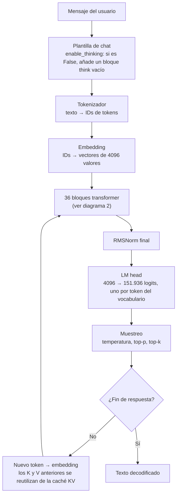
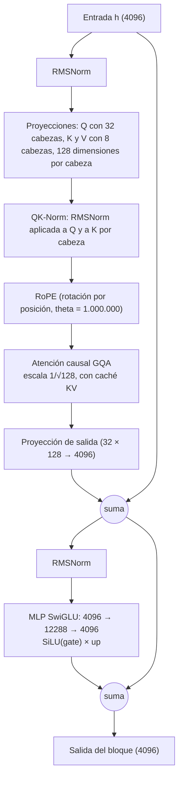
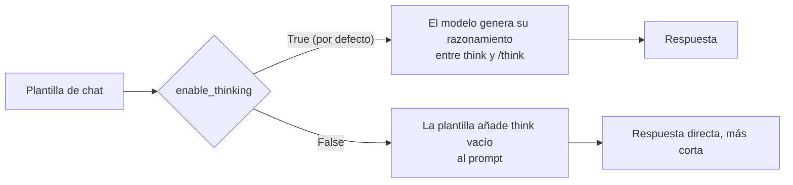

# 002 · Qwen3-8B

**Fuente principal:** https://huggingface.co/Qwen/Qwen3-8B
**Licencia:** Apache 2.0
**Consultado:** 2026-11-06
**Código:** 01-UU-S-002 (catálogo 01 Texto y LLMs · UU · Starter)
**Pokémon asociado:** Porygon — un Pokémon hecho de código informático, nacido en el mundo digital; un modelo de lenguaje que es puro software y puede cambiar entre "pensar" y "responder rápido" encaja con esa idea.

---

## Resumen

Un modelo, dos formas de pensar: Qwen3-8B alterna entre razonar paso a paso y responder rápido, con el mismo conjunto de pesos.

Qwen3-8B es un modelo de lenguaje causal de pesos abiertos (generación de texto) del equipo Qwen, con 8,2 mil millones de parámetros, publicado bajo licencia Apache 2.0, lo que permite usarlo también en proyectos comerciales.

🔧 **Tipo y tecnología:** transformer solo decodificador (decoder-only) con atención de consultas agrupadas (GQA: 32 cabezas de consulta y 8 de clave/valor), 36 capas. El modo de pensamiento viene activado por defecto y se puede desactivar por petición. Se usa desde Python con `transformers`.
📏 **Tamaño:** 8,2 B parámetros (6,95 B sin embeddings). Contexto nativo de 32.768 tokens, hasta 131.072 con YaRN. Pesos en BF16 (safetensors), unos 16,4 GB.
💻 **Hardware mínimo:** unos 24 GB de VRAM para los pesos en BF16 con algo de margen; unos 10 GB en 8 bits y unos 5 GB en 4 bits *(estimación: 8,19 B × bytes por parámetro, más un margen del 20–30 %; ver notas de verificación)*.
🛠️ **Interfaces:** Python (`transformers`), SGLang y vLLM (servidor compatible con la API de OpenAI), y aplicaciones locales como Ollama, LM Studio, MLX-LM y llama.cpp, según la ficha.
👥 **Quién lo usa y para qué:** razonamiento, código, matemáticas, agentes con herramientas externas, y chat y traducción multilingüe (más de 100 idiomas y dialectos, según la ficha). Tiene unos 7 millones de descargas en Hugging Face (snapshot del 2026-11-06).
💡 **Por qué importa:** un solo modelo cubre el chat rápido y el razonamiento largo, así que no hace falta tener dos modelos distintos para cada caso.
🏢 **Detrás del modelo:** el equipo Qwen, que desarrolla los modelos Qwen; la ficha cita el informe técnico de Qwen3 (arXiv:2505.09388).
🤓 **Curiosidad:** puedes cambiar de modo a mitad de conversación añadiendo `/think` o `/no_think` a tu mensaje.

Ficha y ejemplo: https://huggingface.co/Qwen/Qwen3-8B

---

## Ajustes: modo de pensamiento

- **Cambio por turno:** `/think` y `/no_think` en el mensaje del usuario cambian el modo solo en esa respuesta (ejemplo de la ficha).
- **Muestreo recomendado:** en modo pensamiento, Temperature 0.6, TopP 0.95 y TopK 20. La ficha dice **no** usar decodificación voraz (greedy).
- **Longitud de respuesta:** en modo pensamiento las salidas son largas. La ficha sugiere `max_new_tokens` de 32.768 para no cortar la respuesta.

## Hardware mínimo

| Precisión | Pesos | Con margen 20–30 % | Recomendado |
|-----------|-------|--------------------|-------------|
| BF16 / FP16 | 8,19 B × 2 B ≈ 16,4 GB | ≈ 19,7–21,3 GB | GPU con 24 GB de VRAM |
| INT8 | 8,19 B × 1 B ≈ 8,2 GB | ≈ 9,8–10,6 GB | GPU con 12 GB de VRAM |
| INT4 | 8,19 B × 0,5 B ≈ 4,1 GB | ≈ 4,9–5,3 GB | GPU con 8 GB de VRAM |

Los contextos largos necesitan memoria extra para la caché KV, así que el margen es una estimación aproximada. La inferencia en CPU usa la RAM del sistema en lugar de la VRAM y es mucho más lenta.

## Interfaces

- `transformers` (`AutoModelForCausalLM`, `AutoTokenizer`).
- SGLang (`sglang>=0.4.6.post1`) y vLLM (`vllm>=0.8.5`) para una API compatible con OpenAI.
- Ollama, LM Studio, MLX-LM, llama.cpp y KTransformers, que la ficha lista como compatibles con Qwen3.

## Quién lo usa y por qué

- Desarrolladores que necesitan un modelo abierto para razonar y para chat rápido.
- Sistemas de agentes, porque la ficha destaca la llamada a herramientas en ambos modos.
- La ficha reporta unos 7 millones de descargas y 2.170 "me gusta" (snapshot 2026-11-06). No cita usuarios de producción concretos, así que aquí no se citan.

## Por qué importa

Qwen3-8B permite que el mismo modelo razone con extensión en matemáticas o código y responda brevemente en el chat cotidiano, controlado por un interruptor en la plantilla de chat o en el prompt. Su licencia Apache 2.0 permite el uso comercial.

## Detrás del modelo

- **Organización:** equipo Qwen (la ficha menciona Alibaba).
- **Autores:** figuran en el informe técnico de Qwen3, arXiv:2505.09388, como "Qwen Team". La ficha no nombra a los autores individuales. *(Pendiente: confirmar la redacción de la afiliación en el artículo.)*

---

## Cómo ejecutarlo

**Estado: probado (una ejecución).** El ejemplo y la prueba con pensamiento activado se han ejecutado en el equipo de trabajo; los resultados están en la sección "Resultado de la ejecución" de abajo. Los comandos también se habían comprobado antes con la ficha del modelo y con el índice de PyPI.

### a. Requisitos previos

- Python 3.10 o más reciente (la máquina tiene Python 3.12.10).
- Windows 11. Se recomienda una GPU NVIDIA con CUDA y unos 24 GB de VRAM; la CPU funciona pero es lenta y necesita unos 24 GB de RAM.
- Opcional: WSL 2 con Ubuntu, si prefieres herramientas de Linux.

### b. Entorno virtual

PowerShell:

```powershell
python -m venv .venv
.\.venv\Scripts\Activate.ps1
```

Git Bash:

```bash
python -m venv .venv
source .venv/Scripts/activate
```

WSL (Ubuntu):

```bash
python3 -m venv .venv
source .venv/bin/activate
```

### c. Instalación

Instala primero PyTorch, eligiendo la versión con CUDA que corresponda a tu GPU desde https://pytorch.org (el `pip install torch` por defecto puede no usar la GPU).

```powershell
python -m pip install --upgrade pip
pip install torch
```

Después, las librerías de Hugging Face:

```powershell
pip install "transformers>=4.51.0" accelerate
```

`accelerate` es necesario para `device_map="auto"`.

### d. Ejemplo mínimo

Guárdalo como `run_qwen3.py` en una carpeta fuera del proyecto (por ejemplo, en la carpeta scratchpad), no en el entorno global de Python:

```python
from transformers import AutoModelForCausalLM, AutoTokenizer

model_name = "Qwen/Qwen3-8B"

tokenizer = AutoTokenizer.from_pretrained(model_name)
model = AutoModelForCausalLM.from_pretrained(
    model_name,
    torch_dtype="auto",
    device_map="auto",
)

messages = [{"role": "user", "content": "Give me a short introduction to large language models in two sentences."}]
text = tokenizer.apply_chat_template(
    messages,
    tokenize=False,
    add_generation_prompt=True,
    enable_thinking=False,  # sin bloque de razonamiento: respuesta más corta
)
inputs = tokenizer([text], return_tensors="pt").to(model.device)

output_ids = model.generate(**inputs, max_new_tokens=128)
new_tokens = output_ids[0][len(inputs.input_ids[0]):]
print(tokenizer.decode(new_tokens, skip_special_tokens=True).strip())
```

Ejecútalo:

```powershell
python run_qwen3.py
```

La ficha del modelo no tiene acceso restringido, así que no hace falta token de Hugging Face. Si tienes uno (para descargas más rápidas o límites de peticiones), configúralo en la shell y nunca en el código:

```powershell
$env:HF_TOKEN = "<tu-token>"
```

### e. Comprobación

El resultado esperado son dos frases sobre modelos de lenguaje impresas en consola, sin etiquetas `<think>`, porque el ejemplo desactiva el pensamiento. Si la salida está vacía o el proceso se queda sin memoria, revisa los avisos de abajo.

### f. Avisos

- **Tamaño de la descarga:** unos 16,4 GB en BF16, guardados en la caché de Hugging Face (`%USERPROFILE%\.cache\huggingface`).
- **Licencia:** Apache 2.0. No hace falta aceptar ninguna condición en Hugging Face.
- **Hardware:** el ejemplo funciona en CPU pero es lento. En GPU necesita unos 24 GB de VRAM en BF16; con menos VRAM, carga una versión cuantizada.
- **Modo de pensamiento:** viene activado por defecto y genera salidas largas. Pon `max_new_tokens` alto (la ficha sugiere 32.768) si usas ese modo.

### g. Por qué hacen falta los pesos y por qué tarda la descarga

- **Los pesos son el modelo.** El código solo describe cómo se calcula la respuesta; los 8.200 millones de parámetros son los valores que el modelo aprendió durante el entrenamiento. Sin ellos no hay conocimiento que usar, y el programa no puede generar nada.
- **No se pueden generar en local.** Entrenar un modelo así requiere clústeres de GPU durante semanas, así que la única opción práctica es descargar los pesos ya entrenados desde Hugging Face.
- **La descarga es grande.** Qwen3-8B ocupa unos 16,4 GB en BF16. Además, sin token de Hugging Face las peticiones tienen límites de velocidad, y el tiempo depende de la conexión y de la carga del servidor.
- **En el lab de 0,6B:** Qwen3-0.6B ocupa unos 1,2 GB. La primera descarga en este equipo, sin token, todavía no había terminado cuando se escribió esto. *(Pendiente: anotar el tiempo real.)* Como estimación proporcional al tamaño, el 8B (16,4 GB) tardaría unas 13 veces más.
- **Qué se puede hacer para acelerarlo:** definir `HF_TOKEN` (se hace una vez en la sesión, nunca en el código), descargar en un momento con menos tráfico, o usar una versión cuantizada, que pesa menos.

### h. Resultado de la ejecución

Dos ejecuciones con el mismo modelo: una sin pensamiento (el ejemplo de arriba) y otra con `enable_thinking=True`, con `max_new_tokens=256`.

| Ejecución | Tokens generados | Tiempo | Velocidad |
|-----------|------------------|--------|-----------|
| `enable_thinking=False` (límite no indicado en la salida) | 56 | 10,3 s | 5,4 tokens/s |
| `enable_thinking=True`, `max_new_tokens=256` | 166 | 33,4 s | 5,0 tokens/s |

Lo que se observa en la salida:

- Sin pensamiento, la respuesta son dos frases sobre LLMs, sin `<think>`, como indica la comprobación de arriba.
- Con pensamiento, el texto empieza por un bloque `<think>...</think>` con el razonamiento del modelo y después da la respuesta. La respuesta también son dos frases. La generación terminó antes del límite de 256 tokens.
- Con pensamiento, el bloque `<think>` aparece en la salida decodificada. Si quieres solo la respuesta, hay que separar el texto en `</think>`.

*(Pendiente: anotar el hardware, la RAM, la versión de `transformers` y de `torch` con que se midieron estos tiempos. No se han indicado en la prueba.)*

---

## Proceso interno

Los diagramas siguen el código de `transformers` (`modeling_qwen3.py`) y el `config.json` del modelo. Las cifras entre paréntesis salen de ese archivo (ver notas de verificación).

### 1. Qué ocurre al generar una respuesta



El bucle se repite una vez por cada token nuevo. Por eso la velocidad se mide en tokens por segundo: cada token exige pasar otra vez por los 36 bloques.

### 2. Un bloque transformer



Las flechas que saltan de la entrada a la suma son las conexiones residuales. Son las que permiten entrenar 36 capas sin que la señal se pierda.

### 3. El interruptor de pensamiento



La plantilla de chat del repositorio añade `<think>\n\n</think>\n\n` cuando `enable_thinking` es falso. Así el modelo recibe el bloque ya cerrado y responde directamente.

---

## Notas de verificación

| Dato | Valor | Fuente | ¿Verificado? |
|------|-------|--------|--------------|
| Parámetros | 8,2 B (8.190.735.360 en los metadatos safetensors BF16) | Ficha; API de HF `safetensors.parameters` | Sí |
| Parámetros sin embeddings | 6,95 B | Ficha | Sí |
| Capas / atención | 36 capas; 32 cabezas Q / 8 KV (GQA) | Ficha | Sí |
| Contexto | 32.768 nativo; 131.072 con YaRN | Ficha | Sí |
| Licencia | Apache 2.0 | Metadatos de la ficha y enlace a LICENSE | Sí |
| Librería | `transformers` ≥ 4.51.0 | Ficha | Sí |
| Tamaño de pesos | ≈ 16,38 GB (suma de 5 shards; 15,26 GiB) | API de HF `?blobs=true` | Sí |
| Hardware (BF16) | ≈ 19,7–21,3 GB con margen | Cálculo: 8,19 B × 2 B + 20–30 % | **Estimación** |
| Hardware (INT8 / INT4) | ≈ 10 GB / ≈ 5 GB | Cálculo: 8,19 B × 1 B / 0,5 B + margen | **Estimación** |
| Descargas / me gusta | 7.000.357 / 2.170 | API de HF, snapshot 2026-11-06 | Sí (snapshot) |
| Acceso restringido | No | API de HF `gated: false` | Sí |
| Autor | Qwen Team | Cita de la ficha; arXiv:2505.09388 | Sí |
| Organización | Alibaba (mencionada en la ficha) | Ficha | Parcial: redacción de la afiliación pendiente |
| Fecha de publicación | No indicada en la ficha | — | **Pendiente** |
| Comandos de "Cómo ejecutarlo" | Nombres de paquete comprobados en PyPI: `transformers` (5.22.1 la última; 4.51.0+ disponible), `accelerate` (1.15.0), `torch` (2.15.0) | `pip index versions` | Nombres sí; ejecución del ejemplo: sí (ver "Resultado de la ejecución") |
| Hidden size / intermedio | 4096 / 12288 | `config.json` del repositorio | Sí |
| Dimensión por cabeza | 128 | `config.json` (`head_dim`) | Sí |
| Vocabulario | 151.936 | `config.json` (`vocab_size`) | Sí |
| Embedding y LM head | Separados (no comparten pesos) | `config.json` (`tie_word_embeddings: false`) | Sí |
| Base de RoPE | theta = 1.000.000 | `config.json` (`rope_theta`) | Sí |
| Activación del MLP | SiLU, con puerta (SwiGLU) | `config.json` (`hidden_act`); `modeling_qwen3.py` | Sí |
| Normalización | RMSNorm (ε = 1e-6); QK-Norm en Q y K | `config.json`; `modeling_qwen3.py` (`q_norm`, `k_norm`) | Sí |
| Plantilla con pensamiento desactivado | Añade `<think>\n\n</think>\n\n` al prompt | `tokenizer_config.json` (`chat_template`) | Sí |
| Tiempos de la ejecución local | 56 tokens en 10,3 s; 166 tokens en 33,4 s | Salida de la ejecución del usuario | Sí (una ejecución, sin hardware registrado) |

## Pendiente

- Fecha de publicación de Qwen3 (abril de 2025 es de memoria; la ficha no la confirma).
- Confirmar la redacción de la afiliación con Alibaba en el informe técnico.
- Registrar el hardware y las versiones de la ejecución local (GPU, RAM, `transformers`, `torch`); no se han indicado con la salida.
- Verificar las cifras de hardware midiendo la VRAM pico en BF16 y en 4 bits.
- La ficha pide `transformers` ≥ 4.51.0 y la última en PyPI es 5.22.1; comprobar qué versión necesita el ejemplo (el argumento `torch_dtype` podría cambiar en versiones nuevas).
