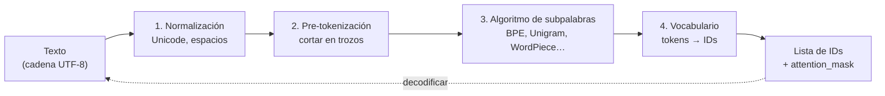

# 01 · Tokenización

**Consultado:** 2026-11-07
**Fuentes:** resumen de tokenizadores de Hugging Face (https://huggingface.co/docs/transformers/tokenizer_summary); Sennrich et al., arXiv:1508.07909 (BPE); Kudo y Richardson, arXiv:1808.06226 (SentencePiece); `tokenizer.json` de Qwen/Qwen3-8B (https://huggingface.co/Qwen/Qwen3-8B/resolve/main/tokenizer.json).

---

## Idea general

La tokenización convierte texto en una lista de números enteros (IDs) que el modelo puede procesar. El modelo nunca ve letras: ve IDs, y cada ID tiene un vector asociado en la tabla de embeddings.

Es un paso fijo y previo a cualquier cálculo de la red. Cada modelo trae su propio tokenizador y su propio vocabulario. Los IDs de un modelo no sirven para otro.

## Input y output

| | Qué es | Ejemplo con Qwen3-8B |
|---|---|---|
| **Input** | Una cadena de texto (UTF-8). En un chat, la plantilla convierte antes la lista de mensajes en una sola cadena con etiquetas de rol. | `"Hola, ¿qué tal?"` |
| **Output** | Lista de IDs (`input_ids`). En `transformers` también se devuelve `attention_mask`: 1 para tokens reales, 0 para relleno. | `[68012, 11, 28286, 63491, 8210, 30]` |
| **Para inspección** | Los tokens como texto, que no se usan en el cálculo. | `['Hola', ',', 'Ġ¿', 'qué', 'Ġtal', '?']` |

La "Ġ" del ejemplo representa un espacio. Los caracteres raros (como "é") son bytes de UTF-8 mostrados como caracteres imprimibles; el texto original se recupera al decodificar.

## Pasos genéricos



1. **Normalización.** Unifica el texto antes de partirlo: forma Unicode, espacios, mayúsculas si el modelo lo pide. Qwen3 usa normalización NFC, que deja cada letra acentuada en un solo carácter.
2. **Pre-tokenización.** Corta el texto en trozos según reglas simples: espacios, palabras, números, signos. Los algoritmos de subpalabras solo trabajan dentro de cada trozo. En Qwen3, cada dígito es un trozo aparte.
3. **Algoritmo de subpalabras.** Decide cómo partir cada trozo en tokens del vocabulario (ver tabla abajo).
4. **Vocabulario.** Cada token tiene un ID fijo. Este paso solo busca el ID de cada token.

Al decodificar se hacen los pasos inversos: IDs → tokens → bytes o texto. Algunos tokens especiales (inicio de turno, fin de respuesta) se eliminan de la salida si se pide.

## Algoritmos de subpalabras

Un token puede ser una palabra entera, un fragmento de palabra o un byte. Los algoritmos aprenden el vocabulario a partir de un corpus de entrenamiento.

| Algoritmo | Idea | Quién lo usa (según HF) |
|---|---|---|
| **BPE** (byte pair encoding) | Empieza con caracteres y fusiona una y otra vez el par más frecuente. | Llama, Gemma, Qwen2, GPT |
| **Byte-level BPE** | Igual que BPE, pero el alfabeto base son los 256 bytes. Nunca hay carácter desconocido. | GPT-2, Qwen3 |
| **Unigram** | Empieza con muchos candidatos y elimina los que menos empeoran la probabilidad del corpus. | T5, BigBird, Pegasus |
| **WordPiece** | Como BPE, pero fusiona el par que más información aporta (frecuencia del par frente a lo esperado por azar). | BERT, DistilBERT, Electra |
| **SentencePiece** | No es un algoritmo, sino una librería que aplica BPE o Unigram al texto crudo, incluyendo el espacio como "▁". Sirve para idiomas sin espacios, como chino o japonés. | El resumen de HF no lista modelos para esta entrada (pendiente de verificar) |

### Ejemplo de BPE (del resumen de Hugging Face)

Corpus de partida, con frecuencias: `hug` (10), `pug` (5), `pun` (12), `bun` (4), `hugs` (5).

1. Alfabeto base: `b g h n p s u`.
2. El par más frecuente es `u`+`g` (aparece en hug, pug, hugs): se fusiona en `ug`.
3. Luego `u`+`n` (en pun, bun): se fusiona en `un`.
4. Se repite hasta llegar al tamaño de vocabulario deseado.

Para tokenizar una palabra nueva, el modelo aplica las fusiones aprendidas en el mismo orden. Con BPE el resultado es determinista.

## Ejemplo real: Qwen3-8B

Qwen3 usa **byte-level BPE** con un pre-tokenizador basado en expresiones regulares. Datos del `tokenizer.json` del repositorio: modelo BPE, 151.643 tokens base, 151.387 fusiones y 26 tokens añadidos (especiales).

Salida de [demo_tokenizacion.py](demo_tokenizacion.py), ejecutado el 2026-11-07 con `tokenizers` 0.23.3:

| Texto | Nº de tokens | Tokens | IDs |
|---|---|---|---|
| `Hola, ¿qué tal?` | 6 | `Hola` `,` `Ġ¿` `qué` `Ġtal` `?` | 68012, 11, 28286, 63491, 8210, 30 |
| `Large language models are powerful.` | 6 | `Large` `Ġlanguage` `Ġmodels` `Ġare` `Ġpowerful` `.` | 34253, 4128, 4119, 525, 7988, 13 |
| `Tokenización` | 2 | `Token` `ización` | 3323, 41500 |
| `hugs` | 2 | `h` `ugs` | 71, 13299 |
| `Ñandú 🤗` | 6 | `Ãij` `and` `ú` `ĠðŁ` `¤` `Ĺ` | 71354, 437, 6654, 11162, 97, 245 |
| ` hola` (con espacio delante) | 2 | `Ġh` `ola` | 305, 7924 |
| `1234567` | 7 | `1` `2` `3` `4` `5` `6` `7` | 16, 17, 18, 19, 20, 21, 22 |

Lo que se observa:

- **El inglés cuesta menos.** Las frases en inglés salen a un token por palabra. El español usa más tokens, y más aún si hay acentos o signos como "¿".
- **Los acentos y los emojis se parten en bytes.** "ó" ocupa dos bytes en UTF-8 y se representa como `ó`. El emoji 🤗 ocupa cuatro bytes y sale en cuatro tokens. Por eso un texto con emojis cuesta más.
- **El espacio va pegado al token siguiente** (`Ġ`). " hola" y "hola" dan IDs distintos.
- **Los números se separan por dígito.** `1234567` son siete tokens. Un número largo gasta mucho contexto.
- **Las palabras comunes son un token** ("Hola", "Large"). Las menos comunes se parten ("Tokenización" → `Token` + `ización`).

## Vocabulario y tamaño

- El tokenizador tiene **151.669 entradas** (151.643 base más 26 especiales), según `get_vocab_size()`.
- La tabla de embeddings del modelo tiene **151.936 filas** (`vocab_size` en `config.json`). Las filas que sobran no corresponden a ningún token del tokenizador. El motivo habitual es alinear el tamaño de la tabla con un número cómodo para la GPU; esto no lo confirma la ficha y queda como suposición.

## Reproducir

Con Python y la librería `tokenizers` (sin descargar los 16 GB del modelo: solo se baja el tokenizador):

```powershell
python -m venv $env:TEMP\venv-tok
& $env:TEMP\venv-tok\Scripts\python.exe -m pip install tokenizers
& $env:TEMP\venv-tok\Scripts\python.exe demo_tokenizacion.py
```

El script está en [demo_tokenizacion.py](demo_tokenizacion.py). Úsalo fuera del proyecto, como recomienda la ficha de 002.

## Notas de verificación

| Dato | Valor | Fuente | ¿Verificado? |
|---|---|---|---|
| Familias de algoritmos y modelos que las usan | BPE, Byte-level BPE, Unigram, WordPiece, SentencePiece | Resumen de tokenizadores de HF | Sí |
| Título y autores de BPE para NLP | "Neural Machine Translation of Rare Words with Subword Units", Sennrich, Haddow, Birch | arXiv:1508.07909 | Sí (página de arXiv) |
| Título y autores de SentencePiece | "SentencePiece: A simple and language independent subword tokenizer…", Kudo, Richardson | arXiv:1808.06226 | Sí (página de arXiv) |
| Modelo del tokenizador de Qwen3-8B | BPE, normalizador NFC, pre-tokenizador regex + ByteLevel | `tokenizer.json` del repositorio | Sí |
| Tokens base y fusiones | 151.643 y 151.387 | `tokenizer.json` | Sí |
| Tokens añadidos | 26 | `tokenizer.json` | Sí |
| Entradas del vocabulario | 151.669 | `get_vocab_size()` con `tokenizers` 0.23.3 | Sí (una ejecución) |
| Filas de embedding | 151.936 | `config.json` (`vocab_size`) | Sí |
| Tokens por frase | Tabla de arriba | `demo_tokenizacion.py`, ejecutado el 2026-11-07 | Sí (una ejecución) |

## Pendiente

- Comprobar que `AutoTokenizer` de `transformers` (el que usa el ejemplo de 002) da los mismos IDs que `tokenizers`. Son el mismo archivo, pero no se ha probado.
- Comprobar la plantilla de chat completa (tokens de rol y `<think>`) con `apply_chat_template`, para mostrar la cadena exacta que recibe el tokenizador en un chat.
- El tamaño de vocabulario de otros modelos no se ha revisado; aquí solo se usa Qwen3-8B.
