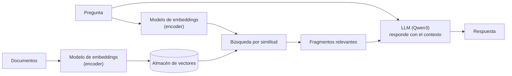
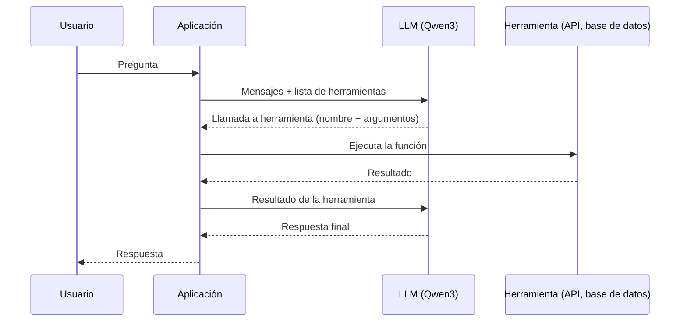
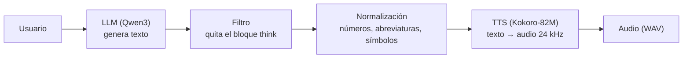

# 03 · Desplegar un LLM e integrarlo con otros componentes

**Consultado:** 2026-11-08
**Base:** la ficha de Qwen3-8B (https://huggingface.co/Qwen/Qwen3-8B, sección de despliegue y uso agéntico), el catálogo de Ollama (https://ollama.com/library/qwen3), las pruebas de `lab-llm/` y el artículo 001 (Kokoro-82M, TTS).

Este documento responde a dos preguntas: cómo se pone un modelo de lenguaje en marcha, y cómo habla con otros componentes (otras arquitecturas, una voz TTS). Lo que no se ha probado en este equipo se marca como tal.

---

## 1. Opciones de despliegue

Un modelo se puede servir de cuatro formas. Cada una tiene un público y un hardware distinto.

| Forma | Qué es | Hardware | Quién lo usa | Estado en nuestro equipo |
|-------|--------|----------|--------------|--------------------------|
| **Python con `transformers`** | El modelo se carga dentro de tu propio programa. | CPU o GPU; los pesos en RAM o VRAM. | Pruebas, investigación, scripts. | Probado con 0,6 B (CPU). El 8 B no cabe. |
| **Ollama** | Programa local que descarga y ejecuta modelos. Expone una API local. | CPU o GPU. | Uso personal, pruebas rápidas. | No probado. El catálogo tiene `qwen3:0.6b` y `qwen3:8b`. |
| **llama.cpp (`llama-server`)** | Servidor en C++ que usa modelos en formato GGUF, cuantizados. | CPU o GPU; el formato cuantizado ocupa mucha menos memoria. | Equipos modestos, uso local. | No probado. La ficha de Qwen3 documenta los parámetros de YaRN para `llama-server`. |
| **vLLM o SGLang** | Servidores para producción, con API compatible con OpenAI. | GPU NVIDIA; el modelo completo en VRAM. | Servicios con varios usuarios. | No probado. La ficha da los comandos. |

### Comandos de la ficha

Para tener una API compatible con OpenAI, la ficha de Qwen3-8B indica:

```shell
# SGLang
python -m sglang.launch_server --model-path Qwen/Qwen3-8B --reasoning-parser qwen3

# vLLM
vllm serve Qwen/Qwen3-8B --enable-reasoning --reasoning-parser deepseek_r1
```

El parámetro `--reasoning-parser` separa el bloque `<think>` de la respuesta en la API, para que la aplicación reciba el razonamiento y la respuesta por separado. Sin él, todo llega en un solo texto.

### Ollama

El catálogo de Ollama tiene las variantes `qwen3:0.6b`, `qwen3:1.7b`, `qwen3:4b`, `qwen3:8b`, `qwen3:14b`, `qwen3:30b` y `qwen3:32b`, entre otras. El tamaño de la descarga y el tipo de cuantización lo indica cada variante en su página; no lo hemos comprobado todavía para `qwen3:8b`.

---

## 2. Cómo se llama al modelo desde código

Con un servidor compatible con OpenAI, cualquier cliente que hable ese protocolo sirve. La aplicación no necesita saber qué modelo hay detrás, solo la dirección del servidor y el nombre del modelo.

```python
from openai import OpenAI

# Servidor local (vLLM, SGLang o llama-server); el puerto depende de cómo se arranque.
cliente = OpenAI(base_url="http://127.0.0.1:8000/v1", api_key="no-necesaria")

respuesta = cliente.chat.completions.create(
    model="Qwen/Qwen3-8B",
    messages=[{"role": "user", "content": "Dame dos frases sobre modelos de lenguaje."}],
)
print(respuesta.choices[0].message.content)
```

*(No probado: el código es el patrón habitual de la API de OpenAI; hay que comprobar el puerto y el nombre del modelo en cada servidor.)*

Dos reglas para que la integración sea estable:
- **Separar el razonamiento de la respuesta** antes de mostrarla o pasarla a otro componente (ver la sección 4).
- **Fijar el límite de tokens** (`max_tokens`) según el modo. Si el límite es bajo, la respuesta llega cortada (ver [02-limites-y-razonamiento.md](02-limites-y-razonamiento.md)).

---

## 3. Interacción con otras arquitecturas

Un LLM rara vez trabaja solo. Estas son las combinaciones más habituales.

### 3.1 Búsqueda semántica y RAG (embeddings)

El modelo no conoce tus documentos. Un modelo de **embeddings** convierte texto en vectores; un almacén de vectores busca los fragmentos más parecidos a la pregunta; y el LLM responde usando esos fragmentos como contexto.



El modelo de embeddings y el LLM son componentes distintos. El primero es un encoder y no genera texto; el segundo es un decoder. En la carpeta `carta/pruebas/` ya hay una carta de prueba para un modelo de embeddings de Qwen3 (`embeddings-qwen3-embedding-06b`), pero no se ha ejecutado en este equipo.

### 3.2 Llamadas a herramientas (agentes)

Qwen3 está entrenado para llamar a herramientas externas. El modelo no ejecuta nada: escribe la llamada (nombre de la función y argumentos), la aplicación la ejecuta, y el resultado vuelve al modelo para que responda. La ficha recomienda **Qwen-Agent** para este uso, porque incluye las plantillas de llamada a herramientas.



### 3.3 Visión y lenguaje (multimodal)

Qwen3-8B es un modelo solo de texto. Si la entrada es una imagen, hace falta un modelo multimodal (catálogo, categoría 06) que describa la imagen en texto, y ese texto se pasa al LLM. También se puede usar un modelo de visión (catálogo, categoría 05) para detectar objetos y pasar la lista al LLM.

### 3.4 Clasificadores y modelos pequeños

No todo necesita un LLM. Una clasificación sencilla (por ejemplo, si un mensaje es una queja o una consulta) puede hacerla un modelo pequeño de tipo encoder, más rápido y barato. El LLM se reserva para la respuesta.

---

## 4. Interacción con un TTS (voz)

El caso del artículo 001 (Kokoro-82M) es un buen ejemplo: el LLM genera texto y el TTS lo convierte en audio. Son dos servicios independientes que se comunican por texto.



### Qué hay que hacer entre los dos

1. **Quitar el bloque de razonamiento.** Si no se quita, el TTS lee `<think>` y todo el razonamiento en voz alta. Con Python, una línea basta:

   ```python
   import re
   limpio = re.sub(r"<think>.*?</think>", "", texto, flags=re.S).strip()
   ```

   Esto lo hemos visto en la salida de las pruebas: el bloque `<think>` aparece dentro del texto decodificado.

2. **Normalizar el texto.** El TTS necesita las cifras y abreviaturas escritas como palabras. El artículo 001 cita la normalización como paso previo (ver [glosario](../glosario.md)).

3. **Trocear por frases.** Un TTS procesa mejor frases cortas. Se puede dividir la respuesta en frases y sintetizar cada una. Así el audio empieza antes, aunque el LLM aún esté escribiendo (streaming).

4. **Medir el tiempo total.** El tiempo hasta el primer audio es la suma del tiempo de generación del LLM y del tiempo de síntesis del TTS.

### Presupuesto de tiempo en nuestro equipo

Cifras medidas en este equipo (Intel Core i7-1355U, 16 GB de RAM, CPU), con una ejecución por dato:

| Componente | Medida | Fuente |
|------------|--------|--------|
| LLM Qwen3-0.6B, sin razonamiento | 5,2 tokens/s (149 tokens en 28,7 s) | `test_qwen3_06b_es.py`, versión actual |
| LLM Qwen3-8B | 0,1 tokens/s (127 tokens en 2.078 s), con parte de los pesos en disco | `test_qwen3_8b.py`, salida del usuario |
| TTS Kokoro-82M, inglés | RTF 1,08 (8,40 s de audio en 9,0 s de síntesis) | Artículo 001, una ejecución |
| TTS Kokoro-82M, español | RTF 0,66 (6,90 s de audio en 4,6 s de síntesis) | Artículo 001, una ejecución |

RTF (factor de tiempo real) es el tiempo de síntesis dividido por la duración del audio. Un RTF menor que 1 significa que el audio se genera más rápido de lo que dura.

Con estos números, un 0,6 B y Kokoro en CPU pueden formar una conversación hablada, con respuestas de unos segundos. Con el 8B en este equipo, la voz llegaría minutos después del texto. No es una medida de calidad del modelo, sino del hardware.

### Servicio para la voz (pendiente)

El artículo 001 prevé un servicio FastAPI con un endpoint `POST /tts` que devuelve un WAV, con el pipeline cargado una sola vez al arrancar. Un servicio de LLM y otro de TTS, separados, se pueden llamar en cadena desde una aplicación. Ninguno de los dos está construido todavía.

---

## 5. Lo que no se ha probado

- Ningún servidor (vLLM, SGLang, llama-server, Ollama) se ha arrancado en este equipo.
- La llamada con cliente OpenAI del apartado 2 no se ha ejecutado.
- El filtro del bloque `<think>` se ha aplicado solo como idea; no hay script que lo pruebe con Kokoro.
- No hay ejemplo de llamada a herramientas: Qwen-Agent no está instalado.

---

## Notas de verificación

| Dato | Valor | Fuente | ¿Verificado? |
|------|-------|--------|--------------|
| Comandos de SGLang y vLLM | `sglang.launch_server --reasoning-parser qwen3`; `vllm serve --enable-reasoning --reasoning-parser deepseek_r1` | Ficha de Qwen3-8B (README del repositorio) | Sí |
| Herramientas de uso local | Ollama, LM Studio, MLX-LM, llama.cpp, KTransformers | Ficha de Qwen3-8B | Sí |
| Qwen-Agent para llamadas a herramientas | Recomendado en la ficha | Ficha de Qwen3-8B | Sí |
| Parámetros YaRN para `llama-server` | `--rope-scaling yarn --rope-scale 4 --yarn-orig-ctx 32768` | Ficha de Qwen3-8B | Sí (no probado) |
| Etiquetas de Ollama para Qwen3 | `qwen3:0.6b`, `qwen3:1.7b`, `qwen3:4b`, `qwen3:8b`, `qwen3:14b`, `qwen3:30b`, `qwen3:32b`, `qwen3:235b` | https://ollama.com/library/qwen3 (consultado 2026-11-08) | Sí (lista de etiquetas; no el contenido de cada una) |
| Tiempos del 0,6 B y del 8B | Tabla de la sección 4 | Ejecuciones del usuario (`lab-llm/`) | Sí (una ejecución cada una) |
| RTF de Kokoro | 1,08 (inglés), 0,66 (español) | Artículo 001 | Sí (una ejecución cada una) |
| Servicio FastAPI de Kokoro | Planificado, no construido | Artículo 001 | Sí |

## Pendiente

- Arrancar un servidor local (por ejemplo `llama-server` con un modelo cuantizado) y probar la llamada del apartado 2.
- Confirmar qué cuantización y tamaño tiene `qwen3:8b` en Ollama.
- Probar el filtro de `<think>` con la salida real de Qwen3 y Kokoro, y medir el tiempo hasta el primer audio.
- Probar una llamada a herramienta con Qwen-Agent.
