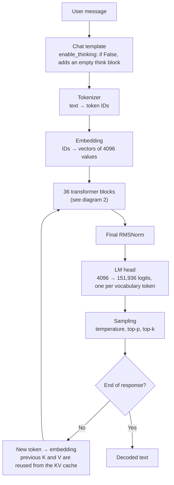
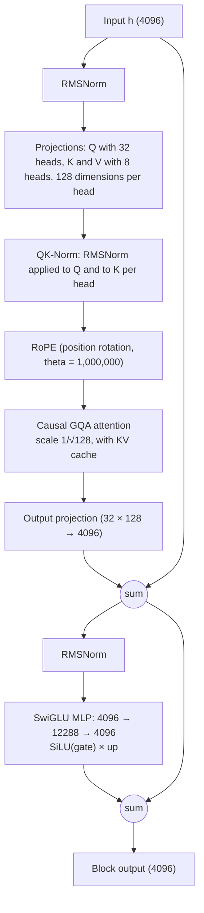
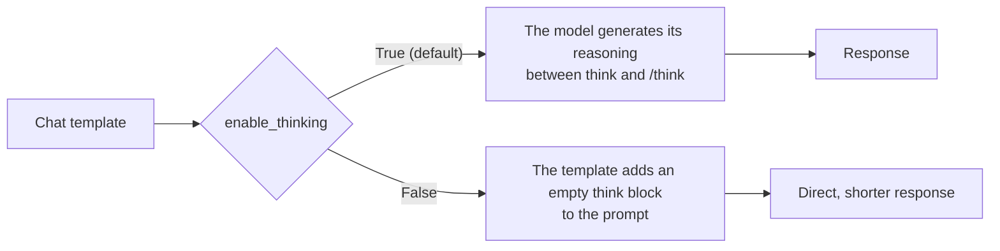

# 002 · Qwen3-8B

**Main source:** https://huggingface.co/Qwen/Qwen3-8B
**License:** Apache 2.0
**Consulted:** 2026-11-06
**Code:** 01-UU-S-002 (catalogue 01 Text and LLMs · UU · Starter)
**Associated Pokémon:** Porygon — a Pokémon made of computer code, born in the digital world; a language model that is pure software and can switch between "thinking" and "answering quickly" fits that idea.

---

## LinkedIn text

One model, two ways of thinking: Qwen3-8B switches between reasoning step by step and answering quickly, with the same set of weights.

Qwen3-8B is an open-weight causal language model (text generation) from the Qwen team, with 8.2 billion parameters, published under the Apache 2.0 license, which also allows it to be used in commercial projects.

🔧 **Type and technology:** decoder-only transformer with grouped-query attention (GQA: 32 query heads and 8 key/value heads), 36 layers. Thinking mode is on by default and can be turned off per request. Used from Python with `transformers`.
📏 **Size:** 8.2 B parameters (6.95 B without embeddings). Native context of 32,768 tokens, up to 131,072 with YaRN. BF16 weights (safetensors), about 16.4 GB.
💻 **Minimum hardware:** about 24 GB of VRAM for the BF16 weights, with some margin; about 10 GB at 8 bits and about 5 GB at 4 bits *(estimate: 8.19 B × bytes per parameter, plus a 20–30 % margin; see verification notes)*.
🛠️ **Interfaces:** Python (`transformers`), SGLang and vLLM (server compatible with the OpenAI API), and local applications such as Ollama, LM Studio, MLX-LM and llama.cpp, according to the model card.
👥 **Who uses it and for what:** reasoning, code, mathematics, agents with external tools, and multilingual chat and translation (more than 100 languages and dialects, according to the model card). It has about 7 million downloads on Hugging Face (snapshot of 2026-11-06).
💡 **Why it matters:** a single model covers both fast chat and long reasoning, so there is no need for two different models for each case.
🏢 **Behind the model:** the Qwen team, which develops the Qwen models; the model card cites the Qwen3 technical report (arXiv:2505.09388).
🤓 **Curiosity:** you can switch mode mid-conversation by adding `/think` or `/no_think` to your message.

Model card and example: https://huggingface.co/Qwen/Qwen3-8B

#LLM #AI #OpenSource

---

## Settings: thinking mode

- **Per-turn switch:** `/think` and `/no_think` in the user message change the mode for that response only (example from the model card).
- **Recommended sampling:** in thinking mode, Temperature 0.6, TopP 0.95 and TopK 20. The model card says **not** to use greedy decoding.
- **Response length:** in thinking mode the outputs are long. The model card suggests `max_new_tokens` of 32,768 so the response is not cut off.

## Minimum hardware

| Precision | Weights | With 20–30 % margin | Recommended |
|-----------|---------|---------------------|-------------|
| BF16 / FP16 | 8.19 B × 2 B ≈ 16.4 GB | ≈ 19.7–21.3 GB | GPU with 24 GB of VRAM |
| INT8 | 8.19 B × 1 B ≈ 8.2 GB | ≈ 9.8–10.6 GB | GPU with 12 GB of VRAM |
| INT4 | 8.19 B × 0.5 B ≈ 4.1 GB | ≈ 4.9–5.3 GB | GPU with 8 GB of VRAM |

Long contexts need extra memory for the KV cache, so the margin is a rough estimate. CPU inference uses system RAM instead of VRAM and is much slower.

## Interfaces

- `transformers` (`AutoModelForCausalLM`, `AutoTokenizer`).
- SGLang (`sglang>=0.4.6.post1`) and vLLM (`vllm>=0.8.5`) for an OpenAI-compatible API.
- Ollama, LM Studio, MLX-LM, llama.cpp and KTransformers, which the model card lists as compatible with Qwen3.

## Who uses it and why

- Developers who need an open model for both reasoning and fast chat.
- Agent systems, because the model card highlights tool calling in both modes.
- The model card reports about 7 million downloads and 2,170 likes (snapshot 2026-11-06). It does not cite specific production users, so none are cited here.

## Why it matters

Qwen3-8B lets the same model reason at length on mathematics or code and answer briefly in everyday chat, controlled by a switch in the chat template or in the prompt. Its Apache 2.0 license allows commercial use.

## Behind the model

- **Organization:** Qwen team (the model card mentions Alibaba).
- **Authors:** listed in the Qwen3 technical report, arXiv:2505.09388, as "Qwen Team". The model card does not name individual authors. *(Pending: confirm the wording of the affiliation in the article.)*

---

## How to run it

**Status: tested (one run).** The example and the test with thinking enabled were run on the work machine; the results are in the "Run result" section below. The commands had also been checked earlier against the model card and the PyPI index.

### a. Prerequisites

- Python 3.10 or newer (the machine has Python 3.12.10).
- Windows 11. An NVIDIA GPU with CUDA and about 24 GB of VRAM is recommended; the CPU works but is slow and needs about 24 GB of RAM.
- Optional: WSL 2 with Ubuntu, if you prefer Linux tools.

### b. Virtual environment

PowerShell:

```powershell
python -m venv .venv
.\.venv\Scripts\Activate.ps1
```

Git Bash:

```bash
python -m venv .venv
source .venv/Scripts/activate
```

WSL (Ubuntu):

```bash
python3 -m venv .venv
source .venv/bin/activate
```

### c. Installation

First install PyTorch, choosing the CUDA version that matches your GPU from https://pytorch.org (the default `pip install torch` may not use the GPU).

```powershell
python -m pip install --upgrade pip
pip install torch
```

Then the Hugging Face libraries:

```powershell
pip install "transformers>=4.51.0" accelerate
```

`accelerate` is required for `device_map="auto"`.

### d. Minimal example

Save it as `run_qwen3.py` in a folder outside the project (for example, in the scratchpad folder), not in the global Python environment:

```python
from transformers import AutoModelForCausalLM, AutoTokenizer

model_name = "Qwen/Qwen3-8B"

tokenizer = AutoTokenizer.from_pretrained(model_name)
model = AutoModelForCausalLM.from_pretrained(
    model_name,
    torch_dtype="auto",
    device_map="auto",
)

messages = [{"role": "user", "content": "Give me a short introduction to large language models in two sentences."}]
text = tokenizer.apply_chat_template(
    messages,
    tokenize=False,
    add_generation_prompt=True,
    enable_thinking=False,  # no reasoning block: shorter answer
)
inputs = tokenizer([text], return_tensors="pt").to(model.device)

output_ids = model.generate(**inputs, max_new_tokens=128)
new_tokens = output_ids[0][len(inputs.input_ids[0]):]
print(tokenizer.decode(new_tokens, skip_special_tokens=True).strip())
```

Run it:

```powershell
python run_qwen3.py
```

The model card is not gated, so no Hugging Face token is needed. If you have one (for faster downloads or higher rate limits), set it in the shell and never in the code:

```powershell
$env:HF_TOKEN = "<your-token>"
```

### e. Check

The expected result is two sentences about language models printed to the console, without `<think>` tags, because the example disables thinking. If the output is empty or the process runs out of memory, check the warnings below.

### f. Warnings

- **Download size:** about 16.4 GB in BF16, stored in the Hugging Face cache (`%USERPROFILE%\.cache\huggingface`).
- **License:** Apache 2.0. No terms need to be accepted on Hugging Face.
- **Hardware:** the example runs on CPU but is slow. On a GPU it needs about 24 GB of VRAM in BF16; with less VRAM, load a quantized version.
- **Thinking mode:** it is on by default and generates long outputs. Set `max_new_tokens` high (the model card suggests 32,768) if you use that mode.

### g. Why the weights are needed and why the download takes time

- **The weights are the model.** The code only describes how the answer is computed; the 8.2 billion parameters are the values the model learned during training. Without them there is no knowledge to use, and the program cannot generate anything.
- **They cannot be generated locally.** Training a model like this requires GPU clusters for weeks, so the only practical option is to download the already-trained weights from Hugging Face.
- **The download is large.** Qwen3-8B takes up about 16.4 GB in BF16. Also, without a Hugging Face token, requests are rate-limited, and the time depends on the connection and the server load.
- **In the 0.6B lab:** Qwen3-0.6B takes up about 1.2 GB. The first download on this machine, without a token, had not finished when this was written. *(Pending: note the actual time.)* As a rough estimate proportional to size, the 8B (16.4 GB) would take about 13 times longer.
- **How to speed it up:** set `HF_TOKEN` (done once per session, never in the code), download at a time with less traffic, or use a quantized version, which is smaller.

### h. Run result

Two runs with the same model: one without thinking (the example above) and one with `enable_thinking=True`, with `max_new_tokens=256`.

| Run | Tokens generated | Time | Speed |
|-----|------------------|------|-------|
| `enable_thinking=False` (limit not stated in the output) | 56 | 10.3 s | 5.4 tokens/s |
| `enable_thinking=True`, `max_new_tokens=256` | 166 | 33.4 s | 5.0 tokens/s |

What is seen in the output:

- Without thinking, the response is two sentences about LLMs, without `<think>`, as the check above indicates.
- With thinking, the text starts with a `<think>...</think>` block containing the model's reasoning and then gives the answer. The answer is also two sentences. Generation finished before the 256-token limit.
- With thinking, the `<think>` block appears in the decoded output. To get only the answer, the text has to be split at `</think>`.

*(Pending: record the hardware, RAM, and the `transformers` and `torch` versions used for these timings. They were not stated in the test.)*

---

## Internal process

The diagrams follow the `transformers` code (`modeling_qwen3.py`) and the model's `config.json`. The figures in parentheses come from that file (see verification notes).

### 1. What happens when a response is generated



The loop repeats once for each new token. That is why speed is measured in tokens per second: each token requires passing through all 36 blocks again.

### 2. One transformer block



The arrows that skip from the input to the sum are the residual connections. They are what allows training 36 layers without the signal getting lost.

### 3. The thinking switch



The repository's chat template adds `<think>\n\n</think>\n\n` when `enable_thinking` is false. The model thus receives the already-closed block and answers directly.

---

## Verification notes

| Data | Value | Source | Verified? |
|------|-------|--------|-----------|
| Parameters | 8.2 B (8,190,735,360 in the BF16 safetensors metadata) | Model card; HF API `safetensors.parameters` | Yes |
| Parameters without embeddings | 6.95 B | Model card | Yes |
| Layers / attention | 36 layers; 32 Q heads / 8 KV heads (GQA) | Model card | Yes |
| Context | 32,768 native; 131,072 with YaRN | Model card | Yes |
| License | Apache 2.0 | Model card metadata and link to LICENSE | Yes |
| Library | `transformers` ≥ 4.51.0 | Model card | Yes |
| Weight size | ≈ 16.38 GB (sum of 5 shards; 15.26 GiB) | HF API `?blobs=true` | Yes |
| Hardware (BF16) | ≈ 19.7–21.3 GB with margin | Calculation: 8.19 B × 2 B + 20–30 % | **Estimate** |
| Hardware (INT8 / INT4) | ≈ 10 GB / ≈ 5 GB | Calculation: 8.19 B × 1 B / 0.5 B + margin | **Estimate** |
| Downloads / likes | 7,000,357 / 2,170 | HF API, snapshot 2026-11-06 | Yes (snapshot) |
| Restricted access | No | HF API `gated: false` | Yes |
| Author | Qwen Team | Model card citation; arXiv:2505.09388 | Yes |
| Organization | Alibaba (mentioned in the model card) | Model card | Partial: affiliation wording pending |
| Publication date | Not stated in the model card | — | **Pending** |
| "How to run it" commands | Package names checked on PyPI: `transformers` (5.22.1 latest; 4.51.0+ available), `accelerate` (1.15.0), `torch` (2.15.0) | `pip index versions` | Names yes; example run: yes (see "Run result") |
| Hidden size / intermediate | 4096 / 12288 | Repository `config.json` | Yes |
| Dimension per head | 128 | `config.json` (`head_dim`) | Yes |
| Vocabulary | 151,936 | `config.json` (`vocab_size`) | Yes |
| Embedding and LM head | Separate (no shared weights) | `config.json` (`tie_word_embeddings: false`) | Yes |
| RoPE base | theta = 1,000,000 | `config.json` (`rope_theta`) | Yes |
| MLP activation | SiLU, gated (SwiGLU) | `config.json` (`hidden_act`); `modeling_qwen3.py` | Yes |
| Normalization | RMSNorm (ε = 1e-6); QK-Norm on Q and K | `config.json`; `modeling_qwen3.py` (`q_norm`, `k_norm`) | Yes |
| Template with thinking disabled | Adds `<think>\n\n</think>\n\n` to the prompt | `tokenizer_config.json` (`chat_template`) | Yes |
| Local run timings | 56 tokens in 10.3 s; 166 tokens in 33.4 s | Output of the user's run | Yes (one run, hardware not recorded) |

## Pending

- Publication date of Qwen3 (April 2025 is from memory; the model card does not confirm it).
- Confirm the wording of the affiliation with Alibaba in the technical report.
- Record the hardware and versions of the local run (GPU, RAM, `transformers`, `torch`); they were not stated in the output.
- Verify the hardware figures by measuring peak VRAM in BF16 and in 4 bits.
- The model card asks for `transformers` ≥ 4.51.0 and the latest on PyPI is 5.22.1; check which version the example needs (the `torch_dtype` argument may change in newer versions).
